<picture>
  <source media="(prefers-color-scheme: dark)" srcset="assets/intro-dark.svg" />
  <source media="(prefers-color-scheme: light)" srcset="assets/intro-light.svg" />
  
</picture>

## Hi, I’m Sun Tao (HSTK)

I’m a graduate student at **Tiangong University**, advised by **Yong Yang**. My research focuses on **pansharpening**: combining panchromatic and multispectral imagery to recover spatial detail while preserving spectral information.

My background is in IoT engineering and competitive programming. I’ve worked on embedded devices, backend services, and web dashboards, and I enjoy turning ideas into working systems. Here I share my projects, experiments, and what I learn along the way.

[Website](https://hstkwow.top/) · [Paper notes](https://hstkwow.top/papers.html) · [Projects](https://hstkwow.top/projects.html) · [Email](mailto:hstkwow@gmail.com)

### Currently exploring

- **Pansharpening & remote sensing:** understanding how fusion methods preserve spatial detail and spectral information.
- **Paper reading:** keeping method notes, diagrams, and questions in my [reading journal](https://hstkwow.top/papers.html).
- **Engineering:** connecting algorithmic ideas with practical software and devices.

### Research & engineering toolkit

| Area | Tools & experience |
| --- | --- |
| Algorithms & graphics | C / C++ · Competitive programming · Software rasterization |
| Embedded & IoT | ESP32 · MQTT · RFID · Environmental sensing |
| Backend | Spring Boot · MyBatis |
| Frontend | Vue · TypeScript · Element UI · ECharts |

### Activity, in orbit

<picture>
  <source media="(prefers-color-scheme: dark)" srcset="assets/activity-dark.svg" />
  <source media="(prefers-color-scheme: light)" srcset="assets/activity-light.svg" />
  
</picture>

Real GitHub contribution data, refreshed daily. Artwork is generated and stored in this repository.
